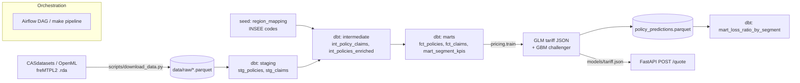

# Motor insurance pricing platform

A small but complete pricing stack on French motor third-party liability data (freMTPL2,
677,991 policies, 26,444 claims): raw files land as parquet, dbt builds tested
staging → intermediate → mart layers in DuckDB, a frequency × severity GLM tariff and a
gradient-boosting challenger are fitted on the marts, model outputs go back into the
warehouse as a loss-ratio mart, and a FastAPI service quotes from the GLM tariff. Airflow
or a single `make pipeline` runs the whole thing in about 40 seconds on a laptop.

## Results

All metrics are on a held-out 20% of policies (135,629 policies, seed 42). The source is
[`results/metrics.json`](results/metrics.json); `make pipeline` regenerates every number below.

### GLM tariff vs GBM challenger

| | Flat rate | GLM (Poisson × Gamma) | GBM (Poisson × Gamma, monotone in bonus-malus) |
|---|---|---|---|
| Frequency: mean Poisson deviance | 0.4718 | 0.4514 | **0.4455** |
| Frequency: deviance explained | – | 4.3% | **5.6%** |
| Frequency Gini | 0 | 0.285 | **0.312** |
| Pure premium Gini, capped claims (95% bootstrap CI) | 0 | 0.309 (0.270–0.349) | **0.338** (0.302–0.381) |
| Pure premium Gini, full incurred (95% CI) | 0 | 0.367 (0.199–0.548) | 0.378 (0.229–0.556) |
| Double lift: mean \|actual/predicted − 1\| over deciles | – | 0.26 | **0.105** |
| Predicted / actual losses on test | 0.935 | 0.935 | 0.933 |

- **The GBM ranks risks better, but not by much.** On capped claims its Gini lead is
  +0.029 with a bootstrap 95% CI of +0.004 to +0.054, so the gain is real but small. On full
  incurred losses the difference (CI −0.055 to +0.075) is lost in the noise of a few very
  large claims.
- **The double lift shows where the two models disagree.** For the 10% of policies the GBM
  prices highest relative to the GLM, actual losses come in at 1.78× the GLM premium and
  1.00× the GBM premium. Most of the GLM's shortfall comes from treating bonus-malus as
  linear on the log scale (see the loss ratios below), and splines or bands on bonus-malus
  would be the first fix to try in the GLM.
- **Severity is close to unpredictable** with these variables. Mean Gamma deviance is
  1.1402 for the null model, 1.1381 for the GLM and 1.1412 for the GBM. Backward selection
  on training-set BIC keeps only driver age, vehicle power and region in the severity GLM.
  Nearly all the segmentation comes from frequency.
- **Large losses matter.** Claims above the training-set 99.5th percentile (€34,986) make up
  24% of incurred cost. They are capped for severity modelling and spread back as a
  ×1.309 load, which keeps the tariff balanced.
- The test set happens to have about 7% more losses than the training-set average. All
  three tariffs show the same 0.93 ratio, so this is sampling noise from large claims, not
  miscalibration.

 

### Key GLM frequency relativities

Base profile: driver aged 51–70, vehicle 1–10 years old, power class 6, regular fuel,
brand B1, region Centre, bonus-malus 50, density e^5.97 ≈ 390 inhabitants/km².
The full table, including severity, regions and 95% CIs, is in
[`results/glm_relativities.csv`](results/glm_relativities.csv).

| Factor | Level | Relativity (95% CI) |
|---|---|---|
| Bonus-malus | per point above 50 | 1.028 (1.027–1.029), i.e. **×3.97 at 100 vs 50** |
| Fuel | Diesel vs regular | 1.18 (1.15–1.22) |
| Driver age | 18–20 | 1.12 (1.02–1.24) |
| | 26–30 | 0.68 (0.65–0.72) |
| | 41–50 | 1.08 (1.04–1.12) |
| Vehicle age | 11+ years | 0.83 (0.80–0.85) |
| Vehicle power | 9+ | 1.17 (1.12–1.23) |
| Population density | ×2 density | 1.05 |
| Region | Limousin (highest) | 1.44 (1.23–1.69) |

Most of the young-driver risk shows up in bonus-malus rather than age: French
drivers start at 100 (the legal CRM scale runs 0.50–3.50), so an 18-year-old already pays
roughly 4× the max-bonus rate before the age relativity. Severity adds its own young-driver
loading of ×1.50 (1.25–1.79) for 18–20.

The GBM agrees on what matters. By mean |SHAP| on the log-frequency scale over 5,000 test
policies, the ranking is bonus-malus 0.41, driver age 0.16, density 0.12, vehicle age 0.10
and fuel 0.09 ([`results/figures/shap_frequency.png`](results/figures/shap_frequency.png)).

### Portfolio and loss-ratio insights (dbt marts)

From `marts.mart_segment_kpis`, across all 358k policy-years: claim frequency is 0.074 per
year, average claim cost €2,266, and pure premium €167 per year.

- Drivers aged 18–20 have 3.2× the portfolio frequency (0.239) and a pure premium of
  €3,206. They account for 0.7% of exposure.
- Frequency rises steadily with density: 0.057 below 100 inhabitants/km² vs 0.096 above
  2,000.
- Bonus-malus is the strongest single split: 0.052 at max bonus (50) vs 0.352 in malus
  (> 100).

`marts.mart_loss_ratio_by_segment` compares each test segment's losses to the premium of
three tariffs. Claims are capped and the excess loaded back. The table shows the
exposure-weighted mean |loss ratio − 1| across each dimension's segments:

| Dimension | Flat | GLM | GBM |
|---|---|---|---|
| Bonus-malus band | 0.360 | 0.113 | **0.046** |
| Driver age band | 0.134 | 0.049 | 0.048 |
| Density band | 0.171 | 0.049 | 0.053 |
| Region (2016) | 0.141 | 0.072 | 0.076 |
| Vehicle brand | 0.137 | 0.099 | 0.099 |

The GLM's straight-line bonus-malus effect underprices the 51–79 band (loss ratio 1.14)
and overprices max bonus (0.90). The GBM's monotone fit gets those to 0.92 and 1.03. On
other dimensions the two tariffs are equally good.

## Architecture



| Layer | What it does |
|---|---|
| `scripts/download_data.py` | Pulls the original CASdatasets `.rda` files (OpenML as fallback) and writes parquet. Raw data is not committed. |
| `dbt/models/staging` | Renames and types columns; one view per source. |
| `dbt/models/intermediate` | Claims rolled up per policy, region reference joined (INSEE codes and 2016 regions), rating bands. |
| `dbt/models/marts` | `fct_policies`, `fct_claims`, `mart_segment_kpis` (frequency, severity, pure premium by segment), and `mart_loss_ratio_by_segment` (tag `post_model`). |
| dbt tests (50) | `unique`, `not_null`, `relationships`, `accepted_values`, plus three custom generic tests (`accepted_range`, `row_count_between` volume checks on sources and marts, `unique_combination`) and a singular test that every policy's ClaimNb matches its claim records. |
| `src/pricing/train.py` | GLMs (statsmodels), GBMs (scikit-learn HistGradientBoosting), metrics, relativities, SHAP, figures. |
| `src/pricing/rating.py`, `api.py` | Pure-Python rating from the tariff JSON; FastAPI `/quote` and `/health`. |
| `dags/motor_pricing_dag.py` | `data → dbt_build → train → dbt_post → [docs, test]`, each task calls the matching `make` target. |
| `.github/workflows/ci.yml` | Lint, download, dbt build and tests on DuckDB, training, post-model dbt, pytest, dbt docs. |

### Modelling choices

- **Frequency:** Poisson GLM with log link and `log(exposure)` offset. Exposure is capped
  at 1 year and claim counts at 4 (standard freMTPL2 cleaning). The bands follow Noll,
  Salzmann & Wüthrich (2018). Area is dropped because it is a banding of density, and using
  both makes the two coefficients unstable.
- **Severity:** Gamma GLM with log link on the average capped claim, weighted by claim
  count. Factors are chosen by backward elimination on training BIC.
- **GBM challenger:** the same two targets with Poisson and Gamma losses. Early stopping
  uses an internal 10% validation split. Bonus-malus has a monotone-increasing constraint
  because a worse claims history must never lower the price. The categoricals are one-hot
  encoded. scikit-learn's native categorical splits are not reproduced correctly by SHAP's
  TreeExplainer (SHAP sums were off by up to 2 on the log scale), so training checks SHAP
  additivity against the model's own predictions and fails if it breaks.
- **Balance:** each component is rescaled so its training-set total matches observed. For
  the GLM the factor goes into the intercept.
- **Selection:** nothing is tuned on the test set.

### Regulation, fairness and explainability

- **No gender.** EU law has banned gender-based insurance pricing since the Test-Achats
  ruling (CJEU C-236/09, applicable from 21 December 2012). freMTPL2 has no gender
  variable, and the API schema has no such field; a test asserts this.
- **Proxies.** Region and density are legitimate rating factors, but they correlate with
  socio-economic characteristics. A production tariff would monitor premium outcomes
  across groups where that data is lawfully available. Here the dbt loss-ratio mart is the
  monitoring hook: it shows by segment whether a tariff over- or under-charges.
- **Explainability.** The GLM is the tariff of record. Each quote returns its base premium
  and one frequency, severity and combined relativity per factor, which multiply exactly
  to the price (tested). The GBM is a challenger used to find where the GLM misfits, for
  example the bonus-malus shape. Its SHAP values are exact decompositions of its
  log-frequency.
- **AI Act.** Annex III lists pricing in life and health insurance as high-risk; motor
  insurance is not on that list. The logging, documentation and tests here still follow
  the same spirit.

## Architecture & cost choices

**DuckDB is the default and Snowflake is the production target.** The whole dataset is
7 MB of parquet, and `dbt build` over it takes about 1 second in DuckDB on a laptop. At this
size a cloud warehouse adds cost and latency without solving any problem, and CI can run
the full build and tests for free.

Snowflake becomes the right call when the platform stops being one person's laptop:

- several years of policy and claims history from operational systems
- several teams (pricing, reserving, finance) reading the same marts
- role-based access and masking on personal data
- BI tools querying concurrently

The project is set up for that switch without a rewrite:

- One dbt project, two targets in `dbt/profiles.yml`. `DBT_TARGET=snowflake` points
  everything at `MOTOR_PRICING`. Sources resolve to parquet files on DuckDB and to
  `RAW.*` / `MODEL_OUTPUTS.*` tables on Snowflake, and `dbt parse --target snowflake`
  resolves every source and model correctly.
- No dbt packages and no adapter-specific SQL. The custom tests are plain SQL.
- [`warehouse/snowflake_setup.sql`](warehouse/snowflake_setup.sql) creates an X-Small
  warehouse with 60 s auto-suspend, a 10-credit monthly resource monitor that suspends at
  100%, a `TRANSFORMER` role, schemas and a parquet stage.
- [`scripts/load_snowflake.py`](scripts/load_snowflake.py) PUTs the parquet files and
  creates tables with `INFER_SCHEMA` + `COPY INTO … MATCH_BY_COLUMN_NAME`, keeping source
  column names so the staging SQL is unchanged.
- An X-Small warehouse costs 1 credit per running hour, billed per second with a 60 s
  minimum, so short monthly runs with auto-suspend stay small. The resource monitor caps
  the worst case.

The Snowflake path has not been run yet. It needs an account; the setup is written but
untested against a live warehouse.

**Other choices:**

- **Tariff as JSON.** The model ships as a few-KB file that an actuary can review and diff.
  The API image needs only FastAPI, Pydantic and Uvicorn, with no pandas, statsmodels or
  scikit-learn.
- **Airflow runs in its own environment.** The DAG only calls `make`, so Airflow's
  dependency tree never meets dbt's or the modelling stack's. The same steps run without
  Airflow.

## How to run

Requires [uv](https://docs.astral.sh/uv/). Python 3.12 is installed by uv.

```bash
uv sync
make pipeline        # download -> dbt build + tests -> train -> loss-ratio mart -> dbt docs -> pytest
```

Individual steps: `make data`, `make dbt-build`, `make train`, `make dbt-post`, `make docs`,
`make test`. Explore the marts with `uv run duckdb data/warehouse.duckdb`, or browse the
docs with `cd dbt && uv run dbt docs serve --profiles-dir .`.

Quote API:

```bash
make serve
curl -s localhost:8000/quote -H 'content-type: application/json' -d '{
  "driver_age": 22, "vehicle_age": 3, "vehicle_power": 7, "bonus_malus": 90,
  "population_density": 2500, "fuel_type": "Diesel", "vehicle_brand": "B12",
  "region_name": "Ile-de-France"}'
```

Docker: `make docker-build && make docker-run`.

Airflow (3.x, in a separate environment):

```bash
uv venv .venv-airflow --python 3.12 && uv pip install --python .venv-airflow "apache-airflow>=3,<4"
export AIRFLOW_HOME=$PWD/.airflow AIRFLOW__CORE__DAGS_FOLDER=$PWD/dags AIRFLOW__CORE__LOAD_EXAMPLES=False
.venv-airflow/bin/airflow standalone            # UI on :8080, or:
.venv-airflow/bin/airflow dags test motor_pricing
```

Snowflake (once an account exists):

```bash
uv sync --extra snowflake
export SNOWFLAKE_ACCOUNT=... SNOWFLAKE_USER=... SNOWFLAKE_PASSWORD=...
# run warehouse/snowflake_setup.sql once
uv run python scripts/load_snowflake.py
DBT_TARGET=snowflake make dbt-build
```

## What has been verified

| Check | Status |
|---|---|
| `make pipeline` from a clean state | Passes locally in about 40 s: 50 dbt tests, 21 pytest tests |
| `airflow dags test motor_pricing` | All 6 tasks succeed (Airflow 3.3.2, separate venv) |
| API rating vs training predictions | Equal to 1e-9 on 500 real policies (`tests/test_pipeline_consistency.py`) |
| `dbt parse` against the Snowflake target | Passes |
| Docker image build | Not run: Docker is not installed on the development machine |
| GitHub Actions workflow | Written; it runs on the first push |
| Snowflake load and build | Not run (no account yet) |

## Limits

- **No written premium.** Loss ratios are actual losses over each model's technical
  (pure) premium, with no expenses, commissions or profit loading.
- **One year of data.** freMTPL2 is a single cross-section, so there is no out-of-time
  validation. The split is a random split by policy. 38% of rows share every rating
  feature with at least one other row, and some of these are probably the same
  policyholder under several policy ids. A grouped split would be stricter, and the test
  metrics may be slightly optimistic for both models.
- **Wide uncertainty on uncapped results.** Full-incurred Gini CIs are wide because a few
  claims (up to €4.1M) dominate the losses. The capped metrics are the more reliable
  comparison.
- **Simplified tariff.** The GLM uses fixed bands and no interactions, and bonus-malus is
  linear on the log scale. That is a deliberately simple baseline, and the double lift
  shows where it falls short.
- **Two snapshots of the data.** CASdatasets has 677,991 policies and 26,444 claims, with
  claim counts that reconcile exactly. OpenML's copy is slightly different (678,013 /
  26,639). The download uses OpenML only if GitHub is unreachable. That path has not been
  exercised here; if its claim counts don't reconcile, `assert_claim_counts_reconcile`
  will fail the build rather than pass silently.

## Data

freMTPL2freq / freMTPL2sev from the R package CASdatasets (Charpentier & Dutang), also on
OpenML (ids 41214 and 41215). Region codes are INSEE codes for the pre-2016 regions.
